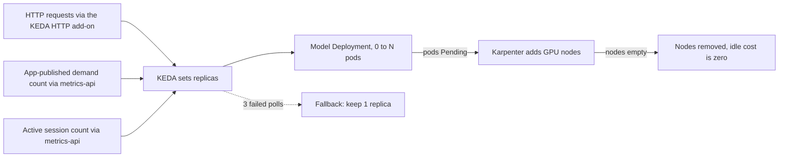
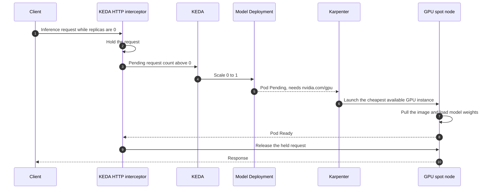
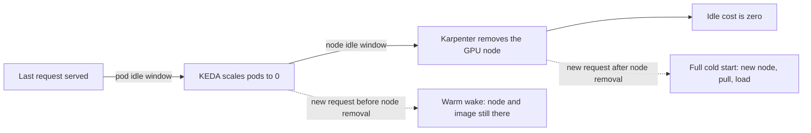
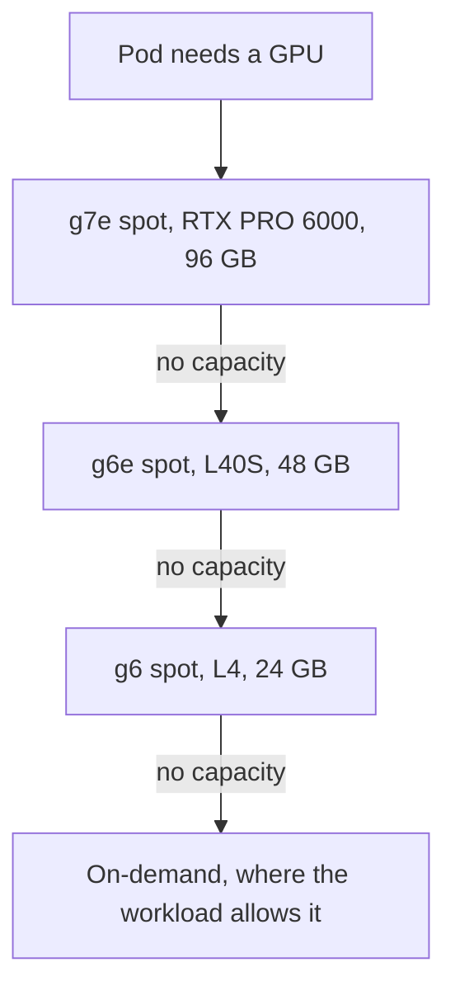

A GPU node that sits idle overnight is not spare capacity. It is a line item. In my current role I run LLM, embedding, OCR, and vision inference on AWS EKS. GPU capacity across EKS and standalone EC2 peaked at **116 NVIDIA GPUs**, including about **55 RTX PRO 6000s** (96 GB, Blackwell). The scale-to-zero pools idle at **$0**.

A full cold start still takes minutes. That is the trade.

{/* truncate */}

Industry write-ups often put average GPU utilization in production clusters around 5%. Scale-to-zero is how you stop paying for the idle 95%.

## One pattern, three triggers

KEDA owns replica count. Karpenter owns nodes. Each model has its own GPU NodePool, isolated with a [value-based taint](/blog/isolating-gpu-pools-with-value-based-taints) so general workloads never land on a GPU.

Three signals feed the same loop:

1. **HTTP requests**, through the KEDA HTTP add-on. The interceptor holds the first cold request until the pod is Ready, then releases it.
2. **An app-published demand count**, through the KEDA `metrics-api` scaler.
3. **An active session count**, also `metrics-api`, polling something like `/internal/session-count`.

If the metrics endpoint breaks, KEDA `fallback` (3 failed polls, then 1 replica) keeps the model up instead of scaling it to zero by accident. Everything is delivered through Argo CD.

A cold request looks like this:

## The teardown ladder

Idle timeouts are a ladder, not one number. First the pod goes to zero. Then the empty node goes away. Tune them together.

The trap is that two ladders can add up to the same total and behave differently. "Pod idle at 15 minutes, node after 30 more" and "pod idle at 30 minutes, node after 15 more" both total 45 minutes. Only the second keeps the pod alive through the 20-minute pauses real users take, and the shorter node window still keeps the image cached for a warm wake.

On the OCR service, a full cold start is about **10–13 minutes**. A warm wake is **70–150 seconds**. Callers need HTTP timeouts of at least 900 seconds, or the cold request dies in the client.

## GPU fallback order

Spot first, then a smaller GPU, then on-demand only where the workload allows it.

Two exceptions, on purpose:

- The OCR service skips the L4. A rough capacity rule for concurrent 32k-token requests is `(0.85 × VRAM in GiB − 14) ÷ 1.08`. That is about 6 requests on a 24 GB L4, 25 on a 48 GB L40S, and 60–65 on a 96 GB RTX PRO 6000. The L4 is not worth it.
- The ~31B NVFP4 model is **Blackwell-only, with no fallback**. If there is no Blackwell capacity, the pod stays Pending and nothing is billed. Details are in [Serving a 31B 4-bit model on Blackwell spot](/blog/serving-a-31b-4bit-model-on-blackwell-spot).

Karpenter tries the **higher** weight first. A working order is g7e at weight 100, then the next family lower. Comments that assume the lower weight wins are backwards.

## What each service actually does

**Embeddings.** Two Text Embeddings Inference services. They started on time-slicing and moved to one exclusive L40S per pod. That story is [What GPU time-slicing does not give you](/blog/what-gpu-time-slicing-does-not-give-you).

**OCR.** A roughly 5B vision-language model on vLLM 0.17, OpenAI-compatible API, one GPU per pod, KEDA HTTP add-on at 0 or 1 replica. Weights are baked into the image (about 17.6 GB compressed, about 49 GB unpacked), so startup does not download a model or mount a PVC. Resources are 4–8 CPU, 16–32 GiB memory, and a 4 GiB `/dev/shm`. The internal ALB idle timeout is 900 seconds.

**Small language model.** A roughly 15 GB vLLM image on GPU spot. Kubernetes service links injected `VLLM_PORT` and broke startup. The fix is `enableServiceLinks: false`.

**Session-triggered GPU.** A KEDA `metrics-api` scaler polls the app's session count. Logout, timeout, or crash drops the count to zero, the pod scales to zero, and Karpenter reclaims the node. A session TTL covers an app crash. Weights come from EFS. This one runs on on-demand L4s, because a spot reclaim mid-session is a failed session, not a discount. Business-hours capacity reservations are the plan for guaranteeing that GPU without paying for nights. I tested the scaler with a stub nginx endpoint that returned a fake count before the real app existed.

HTTP interception lost for this one. The application already owns session state, so the scaler needs no Redis, no Kubernetes credentials, and no gRPC.

## Checklist

1. Scale each model from a real demand signal. CPU on an idle process is not demand.
2. Hold the cold HTTP request in the interceptor, or make the client retry a 503. `metrics-api` with no interceptor returns 503 while replicas are 0.
3. Tune the teardown ladder so a pause does not throw away a warm node, and an empty node does not bill all night.
4. Give each workload its own NodePool and taint value. Keep the taint key as `nvidia.com/gpu`.
5. Size for KV cache, not for the checkpoint file. Exclude GPUs that cannot hold the working set.
6. Plan caller timeouts around a full cold start. Minutes, not a marketing number.
7. Canary a new GPU family before you open a pool to it. Confirm the node advertises `nvidia.com/gpu` before you raise the limit.

Image-pull numbers, and why SOCI lazy loading barely helped, are in [Cutting GPU cold starts on EKS](/blog/cutting-gpu-cold-starts-on-eks).
