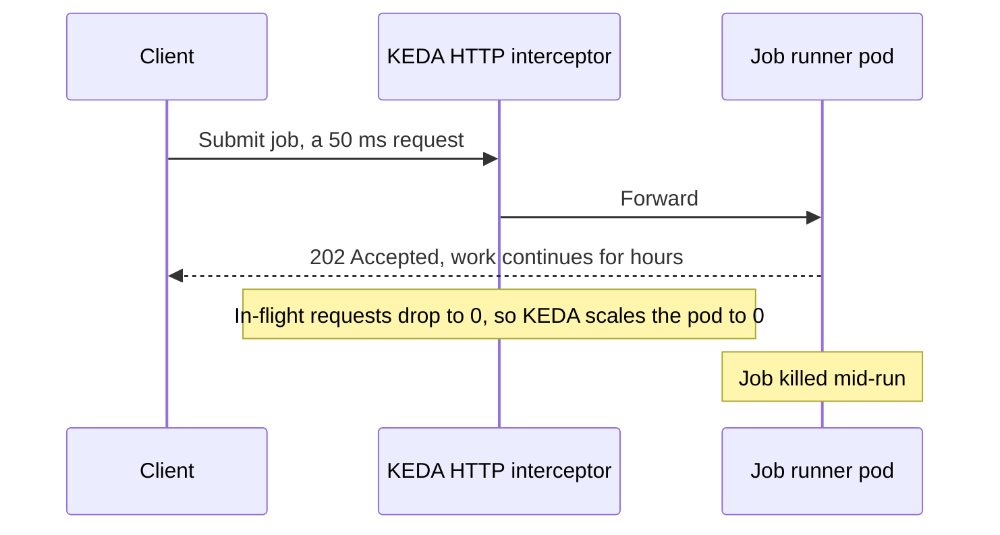
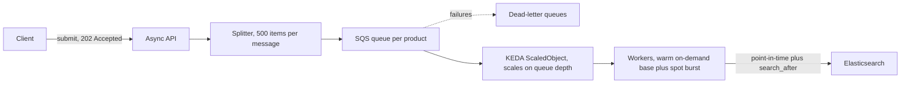

Scale-to-zero is not only a GPU trick. A CPU indexing lane — MySQL extract, chunk, Elasticsearch index, Parquet to S3 — now sits at zero pods and zero nodes when nothing is submitted. The GPU path is in [Scale-to-zero GPU inference on EKS](/blog/scale-to-zero-mlops-on-eks). This is the part that does not need a GPU, and the bug that killed a job that was still working.

{/* truncate */}

## The job runner

The lane uses the KEDA HTTP add-on. All traffic, including health checks, goes through the interceptor. Nodes are c7i-class spot. The IRSA role can write one S3 prefix. Argo CD auto-sync is off on purpose, so a bad sync cannot resize a job that is already running.

Requests started at 12 CPU and 22 GiB, then moved to **40 CPU and 45 GiB**. Those numbers are application config. The process sizes its thread pool from the cgroup CPU quota, so a "small" request silently shrinks the app. Scratch disk is 60 GiB. The node root volume went from 75 to 100 GiB. A cold start is about 60–130 seconds.

Removing the GPU embedding stage from the critical path of the related indexing ETL made that pipeline about **50% faster**.

## KEDA counts requests, not work

The HTTP add-on scales on in-flight requests. A 50 ms "submit job" call, followed by hours of processing, looks idle. KEDA scaled the busy pod to zero mid-job.

The fix is a heartbeat. The client holds a stream open and pings every 15 seconds for as long as the job runs. A `preStop` hold is the backstop if the stream drops. In-flight requests stay above zero until the work is actually done.

## The batch pipeline that kept OOMKilling

A separate document pipeline had the same shape of problem with a different cause. Submission and processing were coupled, workers held huge Elasticsearch reads in memory, and the pods died with exit 137.

What shipped:

- The API returns **202**. A splitter writes SQS, one queue per product, plus dead-letter queues.
- Message boundary: **500 items = one chunk = one message**. KEDA scales on message count.
- A dedicated, tainted, memory-optimized pool. Karpenter keeps a warm on-demand base and bursts onto diversified spot.
- `WhenEmpty` consolidation, plus `do-not-disrupt` on long jobs (100k+ records), with a graceful drain. Spot reclaim is **not** blocked by `do-not-disrupt`. Default consolidation will evict running pods if you do not change the policy.
- Fairness: one pooled consumer, a multi-trigger ScaledObject, round-robin, per-queue DLQs and metrics.

The OOMs were the **reads**, not the ID count. Point-in-time search plus `search_after`, with `_source` filtering, keeps memory flat under `GOMEMLIMIT`.

Capacity is `min(pods × per-pod rate, Elasticsearch ceiling)`. So `maxReplicas` is ceiling divided by per-pod rate. Find the ceiling by adding pods until search rejections start rising. More workers past that point only make Elasticsearch louder.

KEDA's multi-trigger ScaledObject takes the **maximum** of its triggers, not the sum. If you expected the queues to add, you will under-scale.

SQS is the broker here. Temporal only if fan-in orchestration shows up later. Kafka is a poor fit for this work-queue pattern.

## Checklist

1. If the HTTP add-on is the scaler, keep a request in flight for the whole job. A 202 is not work.
2. Size CPU requests from how the process uses its cgroup quota, not from a guess at "enough."
3. Bound external reads. An unbounded Elasticsearch page will OOM a worker that looks idle on CPU.
4. Set `maxReplicas` from the downstream ceiling, then stop.
5. Remember multi-trigger KEDA uses the max, and spot interruption ignores `do-not-disrupt`.
