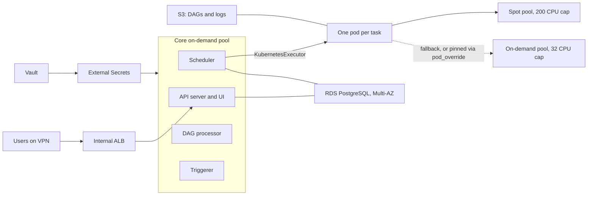
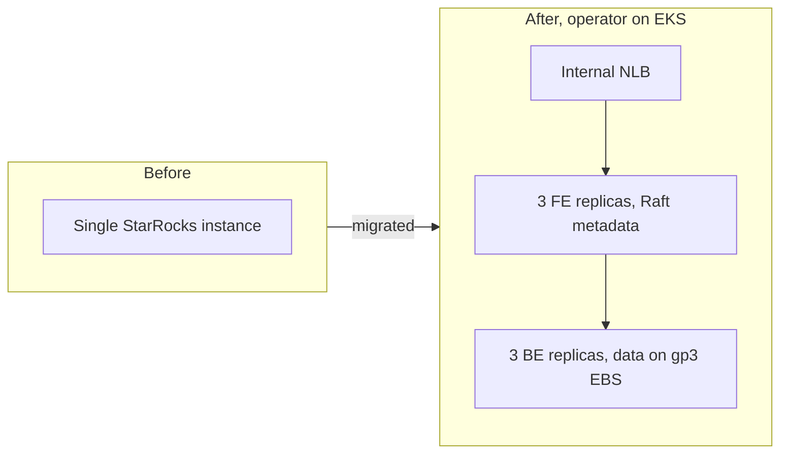

StarRocks and Airflow stay up on their own schedule. They do not scale to zero when an inference session ends, and they do not share a NodePool with a GPU. Both are live in my current role. Airflow runs on the KubernetesExecutor with Karpenter. It does not use KEDA.

{/* truncate */}

## Airflow 3, self-managed, not MWAA

The official Helm chart runs **KubernetesExecutor**: each task is its own pod, and Karpenter supplies the node.

- Task pods land on a **spot** pool capped at 200 CPU, with an **on-demand** fallback capped at 32 CPU. Non-idempotent tasks are pinned to on-demand with `pod_override`.
- Scheduler, DAG processor, triggerer, and API server sit on a core on-demand pool.
- Metadata is external Multi-AZ RDS PostgreSQL, KMS-encrypted. The UI is an internal ALB, reachable only over VPN.
- Secrets come from Vault through External Secrets. DAGs and logs live in S3. The custom amd64 image includes `mysql-client`.



MWAA lost on three points. It cannot scale task capacity the way a KubernetesExecutor can, it costs about **$350 a month just to idle**, it lags on versions, and it gives up control of the image and the executor.

Moving to Airflow 3.1.7 broke five things that the chart does not advertise:

1. The API-server ingress and the DAG processor have to be declared explicitly.
2. The cluster's baseline Pod Security policy required an explicit `securityContext`.
3. 3.1.7 hit a false timeout in the wait-for-migrations step. The database was not stuck. On 3.1.7 the migration check fails unless the FAB database manager is set explicitly, and the wait container reports that as "unapplied migrations." That is [apache/airflow#63847](https://github.com/apache/airflow/issues/63847). The chart values that unstick it:

```yaml
config:
  database:
    external_db_managers: airflow.providers.fab.auth_manager.models.db.FABDBManager
```

4. IRSA was bound to the wrong ServiceAccount.
5. An aws-cli sidecar needed `HOME=/tmp`.

## StarRocks: one box to an operator cluster

The old deployment was a single StarRocks process. One disk, one process, one outage. The replacement is the StarRocks Kubernetes Operator:

- **3 frontend replicas**, Raft for metadata.
- **3 backend replicas**, data on gp3 EBS.
- A dedicated node pool, an internal NLB in front of the FEs, and Prometheus alerts.

Compute-node autoscaling and an S3 lake mode were in the design and were **not** built. The running cluster is FE plus BE on EBS.



A rolling move to r7i.xlarge, plus doubled BE memory, **stopped the OOMKills with zero data loss**.

**The BE reads host memory, not the container cgroup limit.** On cgroup v2 it logs the machine's physical RAM and ignores `memory.max`. That is [StarRocks/starrocks#43225](https://github.com/StarRocks/starrocks/issues/43225), fixed in [StarRocks/starrocks#43270](https://github.com/StarRocks/starrocks/pull/43270). Until the build you are on includes that fix, set `mem_limit` below the container limit, or the process overcommits and dies with exit 137. Set the storage medium to SSD explicitly. I also corrected six config, version, and metric mistakes against the StarRocks 3.5 docs before trusting the dashboards.

Disk growth is part of sizing. Ingestion reached about **40 GB per day per node**, and the data volume went from 260 to 550 GiB in days. Alert with `predict_linear()` on actual growth, and leave disk headroom. A fixed "4 GB a day" assumption will be wrong.

## What I would repeat

- Keep the scheduler and the metadata database on on-demand. Spot is for task pods, and only for tasks you can retry.
- Pin StarRocks FE and BE to the same version. A floating tag will drift them apart.
- Alert on disk growth rate, not on a number you wrote down in the design doc.
