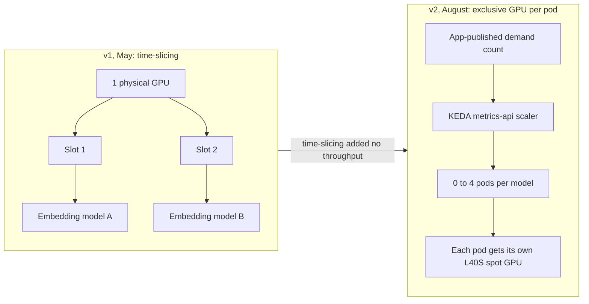

Two embedding models, one physical GPU. That was the May design. By August each pod had its own L40S. Time-slicing had added sharing and **no throughput**.

{/* truncate */}

## v1: two slots on one GPU

The NVIDIA device plugin time-sliced each physical GPU into two slots. A separate device-plugin DaemonSet, with a node selector, covered the spot GPU nodes. Fallback order was g7e, then g6e, then g6.

Scale-to-zero used a KEDA `HTTPScaledObject` and went to zero after 30 minutes idle. While a GPU was up, cost was about **$0.40–1.20 per hour**. Idle was $0. A cold start was about 5 minutes.

Pod anti-affinity had to come off, or the two models could never share a node. After enabling time-slicing, check the node's allocatable GPU count. If it still says 1, the slice config did not land.

## v2: one exclusive GPU per pod

Time-slicing context-switches one GPU between processes. It does not give you a second GPU. For these models, throughput did not move.

Each pod now gets its own **L40S spot** GPU and scales **0 to 4 pods per model** from an app-published demand count. That is the KEDA `metrics-api` scaler, with no interceptor. Cost is about **$0.80 per hour per GPU** while it is running.

## What I would use it for

Time-slicing fits many small, bursty models that are idle most of the time and can tolerate context switches. It does not fit a throughput target.

Two operational notes from the move:

- The `metrics-api` scaler's default 3-second poll timeout kept tripping fallback. Raising it to **10 seconds** stopped that.
- With no interceptor, a request that arrives at zero replicas gets a **503**. The client retries, or you keep a minimum of 1 during busy hours.

`HTTPScaledObject` is deprecated. Plan on `InterceptorRoute` if you stay on the HTTP add-on.

The wider platform is in [Scale-to-zero GPU inference on EKS](/blog/scale-to-zero-mlops-on-eks).
