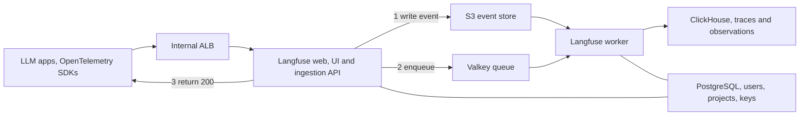

The first Langfuse write-up on this site was an ECS sketch from earlier in the year. What I actually built, in my current role, is Langfuse v3 on EKS. It is validated on a lean tier. Apps are still cutting over from the old Docker Compose box.

These are the seven things that cause real outages, plus how the keys survive the move.

{/* truncate */}

## What shipped

Lean tier, about **$1,000 a month**:

- Langfuse v3 from plain manifests. The Helm chart targets v4.
- One ClickHouse node, Altinity operator. The official ClickHouse operator was still very early.
- Single-AZ RDS PostgreSQL and one Valkey node.
- AWS-managed encryption keys.
- Ingestion over OpenTelemetry at `/api/public/otel`, from OpenAI, Bedrock, Vertex, and in-VPC models.

Langfuse writes each event to **S3 before** it queues it. Losing the single queue node mostly delays processing. The raw event stays recoverable, and the queue buffers about 12 hours. That is why a single queue node was acceptable. The original design called it silent trace loss. It is not.

The cost reassessment that got the estimate from about $3.4K to about $1.0K is [Auditing my own Langfuse estimate](/blog/auditing-my-langfuse-estimate).

## Seven gotchas

1. **`NODE_OPTIONS=--max-old-space-size`.** Node defaults to about a 1.7 GiB heap no matter what the container limit is. This is the most common self-hosted Langfuse crash. Set the heap from the limit you actually gave the pod.

2. **Postgres connections.** Prisma's default pool is 9 per pod. At an HPA max around 33 pods that approaches `max_connections` (about 450). Set `connection_limit=5`.

3. **ClickHouse system log tables have no TTL** and will fill the disk. Disable them in `config.d` on day one.

4. **The queue is not a cache.** Set `maxmemory-policy=noeviction` and alert on any eviction.

5. **ElastiCache Serverless will not work** for this. It has no parameter group, so you cannot set `noeviction`.

6. **Karpenter will consolidate stateful pods** unless you stop it. ClickHouse and the queue do not belong on a pool with aggressive consolidation.

7. **Do not co-locate ClickHouse Keeper with ClickHouse** if you later add replication. Keeper is sensitive to fsync latency. The lean tier skips Keeper entirely. The full design does not.

## Moving off Docker Compose without new API keys

Different salt, encryption key, or auth secret invalidates every existing key. Copy those three values verbatim, and pin the **same Langfuse version**.

- Postgres: `pg_dump -Fc` and `pg_restore`.
- ClickHouse history: native backup files through S3.
- No dual-running. Stop the web tier, drain the worker, copy the delta, flip DNS.

Four things that corrupt the move:

- `docker exec -t` rewrites bytes. Binary dumps come out wrong. Drop the `-t`.
- The RDS admin user is not a superuser. Plan the restore grants around that.
- URL-encode the database password in the connection string.
- `NEXTAUTH_URL` has to match the new URL.

## Gates, not a big-bang cutover

Lean took about five weeks. Full HA would have been eight to ten. Each phase had a gate: `noeviction` and TLS, PVCs binding in-zone, a ClickHouse restore drill, then the first trace end to end. That first-trace gate is what turned an interim budget into a full one. Alerts, SSO, an egress allow-list, and a 3× peak load test come after.

The worker's liveness check is a **stalled-queue check**, not an HTTP ping. An HTTP 200 from a worker that has stopped draining the queue is a green dashboard over a dead pipeline.
