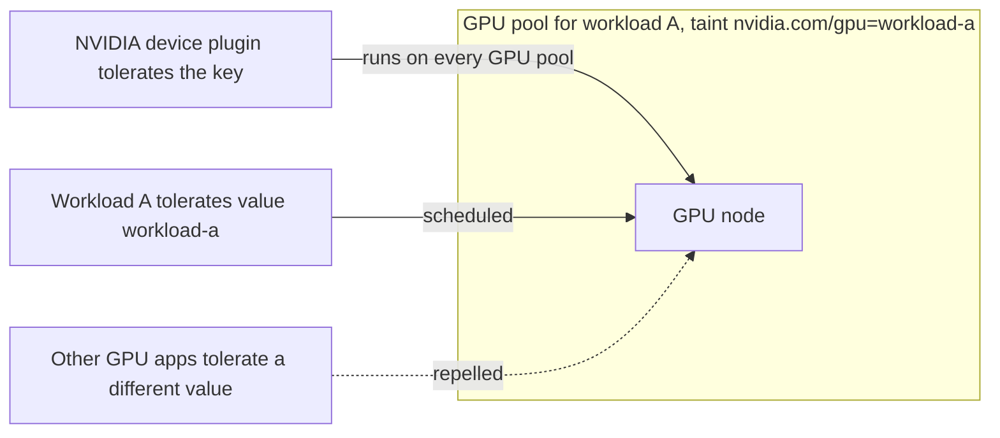

Each GPU workload in my current cluster has its own Karpenter NodePool. The isolation trick is small: keep the taint **key** as `nvidia.com/gpu`, and change only the **value**.

{/* truncate */}

The NVIDIA device plugin tolerates by key (`operator: Exists`), so it still runs on every pool and the nodes still advertise GPUs. Each workload tolerates only its own value (`operator: Equal`), so other GPU apps are repelled.



## The failure mode if you invent a key

A new taint key looks cleaner in a diagram. The device plugin does not tolerate it. It will not run on those nodes. The nodes advertise no GPUs. Pods sit Pending. It looks exactly like a capacity shortage, which is how you waste a day raising quotas.

```yaml
taints:
  - key: nvidia.com/gpu
    value: workload-a
    effect: NoSchedule
```

The matching toleration on the workload uses `operator: Equal` and that same value. The device plugin's toleration stays `operator: Exists` on the key, with no value.

Karpenter still tries the **higher** NodePool weight first. Put the preferred family at the higher weight, not the lower one.

A sanitized reference pool — spot with on-demand fallback, a GPU limit, `WhenEmpty` after 15 minutes, a dated AMI alias, and a 150 GiB gp3 root volume — is the shape behind the Blackwell inference pool. Pin the AMI alias to a dated release. `latest` is how a toolkit bump reaches every GPU node at once.
