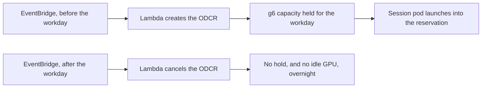

`g6` was not there when the session started. Not on Spot, and not as a normal On-Demand launch either. Karpenter would sit on `InsufficientInstanceCapacity` while a user was already waiting. I used an **On-Demand Capacity Reservation** to hold the instance before business hours, then release it when the day was over.

The point was the GPU existing at the right moment. The smaller bill was a side effect.

{/* truncate */}

## What was actually failing

The session-driven service needs one GPU while someone is in a session, and nothing overnight. Scale-to-zero handles the overnight part. It does not help if AWS has no `g6` to give you at 9 a.m.

A normal On-Demand run is still "launch it now and hope the AZ has one." On the days that mattered, it did not. An always-on Reserved Instance would have kept a box overnight that nobody was using. An ODCR is a hold on a specific instance type, in a specific AZ, for a window I choose.

## The window

EventBridge fires a Lambda before the users' workday and creates the reservation. A second schedule cancels it afterwards. The window covers US Eastern through Pacific hours. Creating it early is the whole trick: the capacity is already matched before the first session, instead of racing a launch at the moment someone logs in.

Compared shapes were g6.2xlarge, g5.2xlarge, and g6e.2xlarge. The reservation I needed was the `g6`, because that was the family that kept coming back empty.

## Billing, once the capacity is the reason

A few rules I checked against AWS docs so the hold did not surprise the bill:

- A running instance inside an ODCR is **not** double-charged. The reservation line is the cost.
- Billing starts when the reservation is created, whether or not a pod has landed on it. If the morning is quiet, you still pay for the hold. That is the price of knowing the card will be there.
- The end time is approximate. Cancel on a schedule, and check that the reservation is actually gone.
- `open` and `targeted` matching are not the same thing. The NodePool has to be able to land on the reservation you just created, or you pay for a hold that Karpenter never uses.
- A regional Reserved Instance and a Savings Plan **do** apply on top of an ODCR. A **zonal** Reserved Instance does not, and stacking one double-charges idle capacity.

The session path this protects is in [Scale-to-zero GPU inference on EKS](/blog/scale-to-zero-mlops-on-eks).
