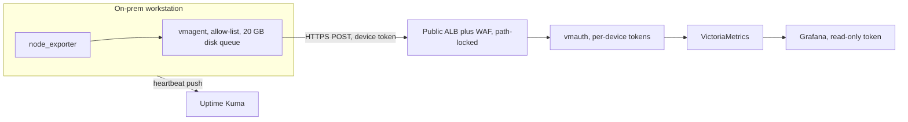

On-prem workstations were reporting health by cron scripts that posted into chat. The replacement ships metrics from macOS and Linux machines into VictoriaMetrics. Planning docs looked at Grafana Alloy over Tailscale. That is not what shipped.

{/* truncate */}

`node_exporter` and **vmagent** run on the device. An allow-list means only `node_*` and `up` leave the machine. Logs stay local. vmagent keeps a **20 GB on-disk queue**, so a site that goes dark for days still drains when the link returns. Alloy's write-ahead log covers roughly **8 hours**. That was the deciding gap.

Devices push HTTPS to a **path-locked public ALB with WAF**. The default response is 403. Only POST on the write path is allowed. **vmauth** checks a per-device token and forwards to VictoriaMetrics. Grafana reads with a different, read-only token. Uptime Kuma, in push mode, alerts when heartbeats stop, which is how you notice a powered-off machine that cannot scrape itself.

Naming is a `device_id` plus a token. macOS keeps the agent up with `launchd`. Onboarding is three steps: a short doc, a script that registers the token, and an onboard script for Linux or Mac. Status codes in the troubleshooting guide map to device, network, receiver, or Grafana, so a 403 is not treated as "the agent is down."

This is phase 3 of the rollout, not a finished fleet.
